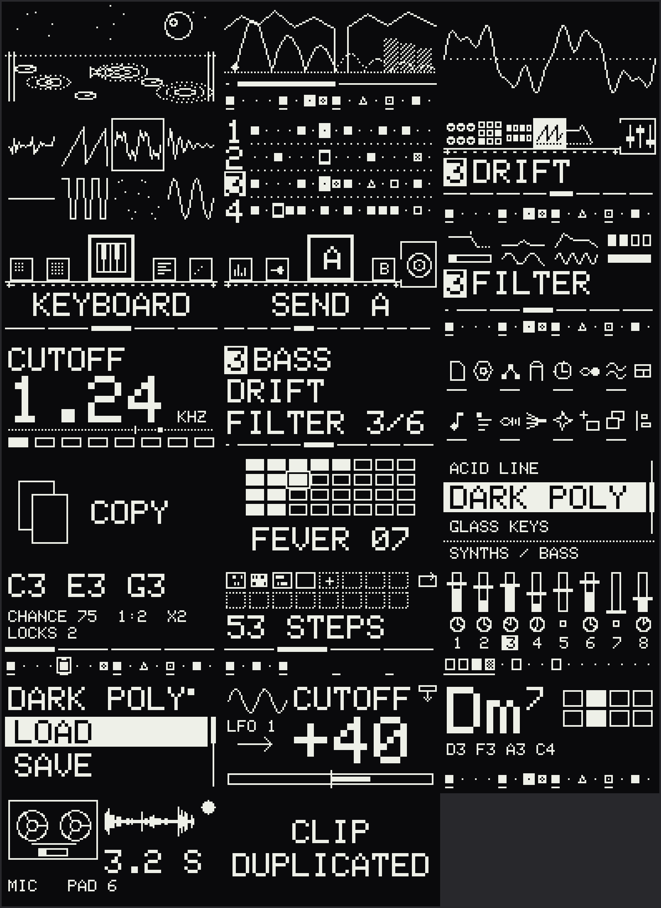

# Feverdream

A standalone groovebox for Ableton Move: eight tracks of synths, samplers, kits, MIDI, effect buses and audio loops,
played the way Move is played. It runs in place of Move's own software.

**Status: design.** Nothing is built yet.

| Read | For |
|---|---|
| [docs/DESIGN.md](docs/DESIGN.md) | how it is played: every control, the screen, the LEDs, each feature |
| [docs/ARCHITECTURE.md](docs/ARCHITECTURE.md) | how it is built, and in what order |
| `design/feverdream.movedesign.json` | the same design as layouts; open it in [Ableton Move Designer](https://quixotic7.github.io/abletonmovedesigner/) (Import) |

| [The design site](https://quixotic7.github.io/feverdream/) (`design/site/`) | the design as an interactive site: the Move state by state, a playable device belt, screens, grammar, sequencing, architecture, decisions |



The site's data is built from the same sources as the board. After changing the documents or the mock-ups:

```bash
python3 design/tools/site.py
```

Then serve `design/site/` with any static server, for example `python3 -m http.server --directory design/site`.
A push to `main` that changes `design/site/` publishes it to GitHub Pages.

The screen pictures and the board are generated:

```bash
python3 design/tools/mock.py
```

This needs Python 3 with Pillow. The board is written by hand in that script for now, so edits made to it in the
Designer are overwritten the next time the script runs.
