# Feverdream: UI/UX design

Draft 28, 24 November 2026. Status: proposal for review. Nothing here is built yet.

Feverdream is a standalone groovebox for Ableton Move. It runs in place of Move's own software, as EvilGenius and
RemoteFM1 do. This document describes how it is played: what every control does, what the screen and LEDs say, and how
each feature on the wish list fits in. The companion documents are `ARCHITECTURE.md` (how it is built) and the board
`design/feverdream.movedesign.json` (the same design as layouts in Ableton Move Designer). Screen pictures below are
generated by `design/tools/mock.py`.

Source for "what Move does": the Move manual (`../AbletonMove/move1-manual-en.md`). Section numbers in brackets, such
as [11.3], refer to it.

## 1. The promise

A Move owner sits down at Feverdream and makes a beat without reading anything. Everything they already know still
works. Everything new is reached by a gesture they already know, and the instrument says what is happening the whole
time.

That gives nine rules. Every later section is an application of them.

1. **Move first.** Every gesture in the Move manual does the same thing here. Nothing is moved or repurposed.
   Features Move lacks are added in places Move leaves empty. There are two deliberate exceptions. The Session
   grid is turned so that all eight tracks fit, following Move's own Control Live Mode (section 8.1). And holding the
   Note/Session toggle is a second Shift instead of a preview of the other mode (section 11.1).
2. **One grammar for everything new.** Move already has three sentence shapes. Feverdream uses only these:
   - *Select, then turn.* The wheel selects a thing; its eight values are on the encoders.
   - *Hold a thing, then turn or press.* While a step, pad, clip or track is held, the controls edit that thing only.
   - *Modifier plus target.* Copy, Delete, Mute or Shift held, then the thing to act on.
3. **Three questions always answered.** Where am I? What do the controls do right now? What just happened? The first is
   answered by the picture on the screen and, in words, by a touch of the wheel; the second by the lights and by
   touching the control; the third by a message that takes the screen for a second.
4. **Modifiers explain themselves.** Holding Shift, Copy, Delete, Mute or Loop shows a hint card on the screen and
   lights the controls that are valid targets. A player never has to remember a combination; holding the modifier
   shows the options.
5. **No hidden modes.** Any state that changes what a control does is shown by a lit button and a symbol in the screen's corner.
   Back always goes up one level. Holding Back always returns to the mode's home screen.
6. **Two hands, never three.** Feverdream is played in the lap, held like a game controller: the left hand at the
   wheel, Back and Note/Session, the right hand on the pads and encoders. Every combination can be made with a
   modifier under one hand and its target under the other, without putting the unit down.
7. **Everything can be said.** Feverdream has a spoken interface for a screen reader, designed in from the first
   screen. Every view, popup, value and change of state is written as words first; the screen draws them and the
   voice says them. Nothing is shown that cannot be said (section 3.4).
8. **Big, simple, told on touch.** The screen is small, so nothing depends on small text. At rest it is a picture.
   A touched knob or wheel takes the whole screen and says what it is, large (section 3.1).
9. **Modulation is seen; the hand's value holds still.** A parameter moved by a macro, a step lock, an envelope or
   an LFO is drawn moving. A touched knob always shows the value being set (section 3.1).

Each item below is tagged: **[M]** identical to Move, **[M+]** a Move gesture carried further, **[New]** new.

### 1.1 Words for presses

Three words are used for button input everywhere in this document, the board and the code.

| Word | Means |
|---|---|
| **Quick click** | pressed and released inside the hold window |
| **Hold** | still down when the hold window ends. From that moment the button is *held* |
| **Double click** | two quick clicks, the second press inside the double-click window after the first release |

The **hold window** is 300 ms. It is one value, defined in one place and read by everything that needs it: the
instrument, the simulator, the web remote and the test scripts (`ARCHITECTURE.md`, section 6). The double-click window
is a second such value, also 300 ms.

For any control that has more than one of these in the current mode, each is decided before anything of it shows.
This is rule R2 of the owner's UX rules for RemoteFM1 (`rfm1cs-abletonmove/design/UX-RULES.md`, 21 November 2026),
which Feverdream adopts whole (section 1.2).

1. **A press shows as a press, and nothing more.** The control lights the moment it goes down: a pad or step white,
   a button full. No menu, hint card, popup or other light belonging to its click, hold or double click appears yet.
2. **A hold acts when the hold window ends** with the control still down. Never at the release, and its release then
   does nothing.
3. **A quick click acts at the release** when the control has no double click. When it has one, the click acts once
   the double-click window has passed with no second press.
4. **A double click acts at its second press.**
5. Nothing belonging to one of the three ever shows for another.

A control with only a click acts on the press.

Two refinements, both already in RemoteFM1's rules:

- **A combination made inside the window counts at once.** Shift pressed and a step pressed 100 ms later is
  Shift + step, without waiting. The first button becomes held at that moment and its quick click is cancelled. Its
  hint card still waits for the window, so a fast player never sees a card flash. (RemoteFM1: a held layer is active
  "once held 300 ms, or something pressed meanwhile".)
- **A click that is where the others begin acts at once.** When the double click or the hold would start with the
  click's effect anyway, the click does not wait. Two kinds: *the same thing sooner* (a clip: click launches at the
  bar, double click launches now) and *the same selection first* (a track's step: click selects it, double click
  selects it and opens it). Nothing wrong can show, and nothing is 300 ms late.

One more of the same kind, proposed here:

- **A shared start happens on the press.** Where the quick click and the hold begin with the same thing, that thing
  starts when the button goes down and only the difference is decided at the window. A pad sounds its note on the
  press. In Sampling Mode the recording starts on the press; released inside the window it keeps recording until the
  next press, held past it the recording stops on release.

Encoder and wheel touch is not a button press and is not covered: a touch shows its parameter at once, as on Move.

### 1.2 The owner's standing rules

RemoteFM1's UX rules apply here unchanged. R2 is section 1.1. The others, in short, with what each means for
Feverdream:

| Rule | Says | Here |
|---|---|---|
| The measure | UX = (intent x feedback x continuity) / (learning + noise). Feedback comes first | every section below is judged by it |
| R1 Feedback at once | every input gives an immediate visible change; a message never waits for the release of the control that caused it; a control with nothing to do in a layer is dark | the press light of 1.1; toasts appear on the action, not on let-go; dead controls are unlit |
| R3 A layer takes what it uses | a layer that uses some knobs takes all eight, some pads all pads, some steps all steps; the ones with no job are dark and dead. A layer that draws a menu takes the jog wheel and Back closes it. A menu's jog selects, its click edits, click again selects | hint-card layers, menus, Loop Mode and Sampling Mode all follow it; nothing falls through a half-used group |
| R4 A knob in use is lit | the light under a knob is on whenever something uses it | encoder lights: on when the encoder has a job, red when its parameter is automated [M], off when dead |
| R5 A knob says what it does | touching shows its name, turning shows its value; where there is a picture, it must show which knob does what and the value changing | the touch view (section 3.1): the name, the value large, and eight marks showing which encoder it is |
| R6 The icon under a step | lit when the step is a function, dark when it is a step, a track, a page or a length. A function goes on the step whose printed icon means it. At rest no icon is lit | the Shift map (section 11); in Session Mode the steps are tracks, so their icons stay dark |

## 2. What a project is

Feverdream says *project* where Move says *Set*.

| Thing | Move | Feverdream |
|---|---|---|
| Projects | 32 Sets on the pads | 32 projects on the pads |
| Tracks | 4 | 8, plus Send A, Send B and Master |
| Track contents | instrument + 2 effects | a chain of devices, as in Live: pad layout, sequencer, MIDI effects, instrument, audio effects, mix strip; with macros over them |
| Clips per track | 8 | 16 (four on the pads at a time) |
| Clip length | up to 16 bars | up to 16 pages of 16 steps, or any number of steps from 1 to 256 |
| Step timing | one step grid for the Set | a speed per clip, from 1/16X to 2X: a bar a step to a 32nd note a step |
| Scenes | a column of clips | a row of clips across all 8 tracks; 16 scenes |
| Main effects | 2 for the Set | a chain of audio effects on each send and on Master, then the limiter |

A track is one of seven types. The type decides what the pads play and which instrument sits in the chain.

| Type | Instrument | Pads | Steps show |
|---|---|---|---|
| Synth | a synthesizer | 32 notes: In Key, Chromatic [M] or Keyboard (section 6.3) | every note [M] |
| Sampler | one sample played across the keys | 32 notes [M] | every note [M] |
| Sample Kit | 16 samples | left 16: the kit; right 16: 16 Pitches [M] | the selected pad [M] |
| Synth Kit | 16 drum synth voices | as Sample Kit | the selected pad |
| MIDI | none; sends notes and CCs out | 32 notes, or the kit layout | every note |
| FX Bus | none; processes audio from other tracks or the input | effect punch-ins | parameter locks only |
| Audio Loops | one audio loop per clip, stretched to tempo | left 16: slices; right 16: pitch and direction | slice triggers |

The type is not a setting to hunt for. It changes when a preset of another type is loaded from the browser, exactly as
Move swaps a synth for a Melodic Sampler when you sample into it [15.3]. Undo brings the old track back.

## 3. Feedback: screen, LEDs, toasts

### 3.1 The screen: big, one thing, told on touch

The Move's screen is 128 x 64 dots on a panel about three centimetres wide. Small text on it is hard to read, so
Feverdream does not rely on any. Three rules govern every screen.

1. **Pictures at rest, words on touch.** With nothing touched, the screen is a picture: the chain as icons, a page as
   eight pictograms, the clips as a grid. Words appear when a control is touched or turned, and they are about that
   control.
2. **One thing, full screen.** Whatever is being touched or changed takes the whole screen: its name large, its
   value larger. There are no dense pages, no boxes inside boxes and no status line of small print.
3. **Big type only.** Three sizes: the one number that matters at about half the screen's height, names and words at
   about a quarter, and a single smaller line where a second fact is needed. No more than three lines of text are
   ever on the screen. A name too long for its line slides.

**The rest view** of any place has the same parts:

| Part | Is |
|---|---|
| The picture | what this place is: the chain's icons, a device's theme, a page's eight pictograms, the clip grid |
| One large line | the name of what the wheel is on, with the track's number in a box at its left |
| The strip | a thin line of segments, the current one thick: where you are in a row of pages or devices |
| The steps row | the 16 steps of the page shown, as marks: Move's loop bars [12.1] and RemoteFM1's steps row together |
| The corner | at the top right, one symbol when a state is latched: Shift, Loop, Fill, Record, the map row |

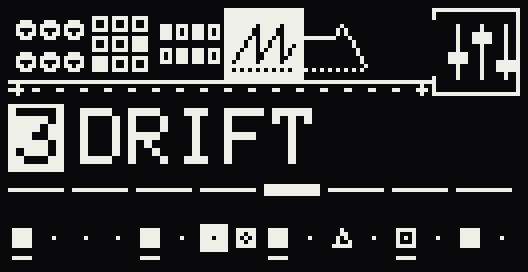 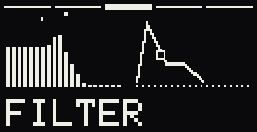

**The touch views** replace the rest view while a control is touched and for a second after:

| Touched | The screen |
|---|---|
| An encoder | its parameter: the name large, the value being set as the largest thing, a thin bar for where modulation has it now, and a row of eight marks showing which encoder it is. This is all a turn ever shows [M, and rule R5] |
| The wheel | where you are, in words: the track, the device, the page and its place (`3 BASS`, `DRIFT`, `FILTER 3/6`). With Speech on Jog, this is also said |
| Volume | the level it sets and its meter |
| A step, held | the step: its notes or chord named large, with marks for what is set on it (section 7.2) |
| A modifier, held | its picture and its one word (section 3.3) |

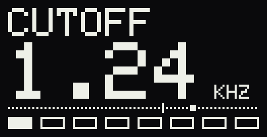 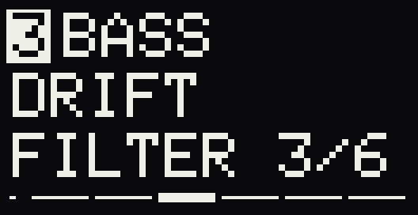

**Live values: what moves, and what holds still.** A parameter that is being moved by something other than the
hand is seen moving. This is a rule, not an ornament: modulation is invisible otherwise.

- **At rest, a pictogram draws the value the sound is using now.** If an LFO sweeps the cutoff, the cutoff's curve
  sweeps. If a macro, a step lock, an envelope or automation moves a parameter, its pictogram moves with it, at the
  speed and by the amount it is really moved. A page at rest is therefore a picture of the modulation at work.
- **The value set by hand is still there**, as a fixed mark on the pictogram, so the swing is seen against where
  the knob stands.
- **A touched knob always shows the value being set.** The moment an encoder is touched, the number on the screen
  is the value the hand controls and nothing else, and it holds still. It never shows the modulated value, so the
  number never runs away from the fingers.
- While the knob is touched the modulation is not hidden: a thin bar under the number carries a fixed tick for the
  set value and a moving mark for the live one. The text holds still; only the mark moves.
- At the chain the macros follow the same rule, and so does a macro's own knob when it is touched.
- For a parameter with a value for each voice, what is shown is the newest note's.

**A message** takes the whole screen for a second, in at most two large lines: `CLIP` / `DUPLICATED`, `TRACK 3` /
`MUTED`, `UNDO` / `DELETE CLIP`. Move shows these confirmations already; Feverdream shows one for every action that
changes the project and for nothing else.

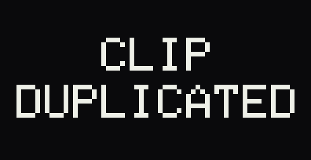

What used to be small print is not lost. It is reached by touch, one thing at a time, and all of it can be spoken
(section 3.4).

### 3.2 LED language

Move's colour meanings are kept exactly and never used for anything else. Track colours are chosen to avoid them.

| Colour | Means | Where Move uses it |
|---|---|---|
| White | selected, or a step that holds notes | steps, clips, tracks |
| Track colour | exists and belongs to this track | clips, empty steps in a clip, root notes |
| Dim grey | available but empty | steps outside the loop, empty slots |
| Green | playing, the playhead, queued to play | steps, clips |
| Red | recording, automation | Record, encoder LEDs, automation range on steps |
| Pink | sampling: this pad can take a sample | pads in Sampling Mode |
| Blue | solo | track buttons |
| Pulsing | selected and waiting, or about to change | selected Set, queued clip |

Feverdream adds three meanings, each a variation of one above:

- **Bright track colour on a step**: the step holds parameter locks but no note.
- **Amber**: a held modifier's valid targets (section 3.3). Amber is used for nothing else.
- **Half-bright white on a track button**: the track is selected but belongs to the other bank (section 4).

Default track colours run warm to cool so the two banks look different at a glance: tracks 1-4 orange, amber, yellow,
chartreuse; tracks 5-8 turquoise, sky, periwinkle, purple. None is close to green, red, pink or blue.

### 3.3 Hint cards

A modifier that is held (section 1.1) takes the screen with its picture and its one word, and lights every valid
target amber. The lights are the list of what it can do; the screen does not spell the list out in small print, and
Speech reads it for whoever wants it.

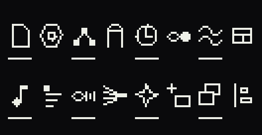 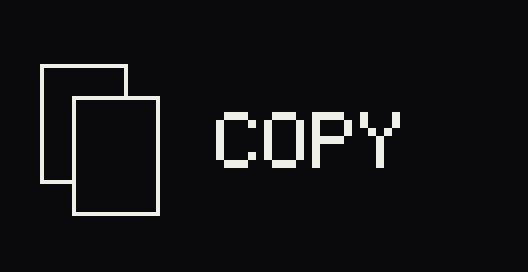

| Held | Screen | LEDs |
|---|---|---|
| Shift, or Note/Session | the sixteen step icons, drawn large in two rows of eight as the steps lie. Pressing one shows its name large | printed step icons light [M]; track buttons show the other bank |
| Copy | two sheets and `COPY` | steps, pads, clips, the wheel (device) |
| Delete | scissors and `DELETE` | the same, plus encoders that have automation |
| Mute | a struck speaker and `MUTE` | track buttons; encoder LEDs show automation status [M, 14.2.2] |
| Loop | the clip's pages as boxes and its length large | step buttons show pages [M] |
| A step | the step, named large (section 7.2) | pads show the step's notes in white [M, 11.9] |
| A track button | the track's number and name large | encoders 1-4 lit |

Copy and Delete have no click of their own, so their mark appears at the press and they take nothing by accident
(section 7.7). What they take is marked where it is, dashed for copied and crossed for cut; nothing pops up, and Back
clears the marks.

### 3.4 The spoken interface

Feverdream is built to be played without the screen. This is rule 7 of section 1, not a feature added at the end:
a view, a popup, a value or a change of state does not exist in the design until it has its words. The voice is
Schwung's screen reader, which the Move already has; Feverdream supplies the words.

**What is said**, after RemoteFM1 and Schwung's conventions: short, "label: value", views by their name, digits for
numbers, note names as the screen has them.

| Kind | When | Examples |
|---|---|---|
| A view | the base view changes; not when a popup over it closes | `Session`, `Track 3, Bass, Synth`, `Projects`, `Loop, 3 pages + 5`, `Sampling, Mic`, `Chords layout` |
| A value | a popup's words or the selection change | `Filter Frequency: 1.24 kilohertz`, `Chance: 50%`, `Voicing: +2`, `Dark Poly Pad`, `Speed: one and a half times` |
| A change with no popup | when it happens | `Track 3 muted`, `Step 5 on`, `Page 2`, `Clip 2 queued`, `Playing`, `Record on`, `Octave +1`, `Step 5 cut`, `Fill` |
| A modifier | when it is held | `Shift`, `Copy`, `Delete`, `Mute`, `Loop` |
| A chord or note, on request | when a step is held, or a chord pad is saved | `D minor seven`, `C3, E3, G3` |

Notes played on the pads are not named while playing: the sound is the feedback.

**The Speech setting**, first in Setup, as in RemoteFM1:

| Mode | Says |
|---|---|
| Off | nothing. The default |
| On | every word |
| **Jog** | only while the wheel is touched. The touch says the screen as it is now; every word after that is said for as long as the finger stays on the wheel; letting go is silence. A new touch starts again |

Changing the setting is said in every mode (`Speech off`, `Speech on`, `Speech jog wheel`). Until a mode has been
chosen, Speech is On if the system's screen reader is on, so that a blind player is never locked out.

Jog is the mode for a sighted player who sometimes wants to be told: rest a finger on the wheel and ask. It costs
nothing, because the left hand lives on the wheel (rule 6).

**What follows for the rest of the design:**

- Every page can describe itself whole in a sentence or two, because a touch in Jog mode asks for exactly that.
- Pictures are never the only carrier. A theme, a pictogram or a light always has words behind it: the filter's curve
  is also `Cutoff: 1.24 kilohertz`, a pulsing green pad is also `Clip 2 queued`.
- Lists, menus and the browser say the item the wheel lands on.
- Colour alone never tells two things apart without words to match.

### 3.5 The belt

EvilGenius on the Move chooses its pages on a **belt**: each page is a box of pixel art riding a conveyor, the
chosen one large in the middle, its name under the belt, the wheel moving it a box at a time. Feverdream takes the
belt as its one picture for choosing among kinds of thing.

- **The belt moves; the choice stays in the middle.** A turn of the wheel slides the belt one box, on a spring, in
  under a fifth of a second. The eye never has to follow a cursor across the screen.
- **A box is pixel art, not a word.** Each kind has its own small picture; the chosen box is large enough to read
  it. The name of the chosen one stands large under the belt, and is said (rule 7).
- **A press takes the box in the middle. Back leaves** with nothing changed.
- **A box that is a device or a kind is entered with a press**, and until then the encoders keep their job, as in
  EvilGenius. **A box that is a page is live as it reaches the middle**, as a page inside a device is. Session
  Mode's belt has both (section 8.2).
- The strip under the name shows how long the belt is and where the choice is on it.
- With Reduce Motion the belt jumps a box with no slide.

Where the belt is used:

| Belt | Boxes | Runs into |
|---|---|---|
| **The chain** (section 6) | the track's devices, in signal order, each box its theme's emblem | the machine at the right: MIX, the last device, where the sound leaves |
| **Session Mode's wheel** (sections 8.2, 8.3) | the mixer's pages SCOPES, LEVEL, PAN, SEND A, SEND B, then each bus's effects | the machine at the right: OUT, the limiter and the way out |
| **Pad layouts** (Shift + Step 8) | In Key, Chromatic, Keyboard, Chords, Progression, Perform | |
| **Track types** (Track Setup) | Synth, Sampler, Sample Kit, Synth Kit, MIDI, FX Bus, Audio Loops | |
| **Adding a device** (a press on a +) | the kinds of device that fit that place; a press opens that kind's list | |
| **Tools** (Shift + Step 13) | transpose, shift, reverse, randomize and the rest | |
| **Views** | Chain, Scene, Scope, Scope 8, Tracks, shown for a moment as the track button steps through them | |

A belt is for a handful of kinds that each deserve a picture. Things with names and no pictures, such as presets,
samples and projects' options, stay lists (section 6.2).

 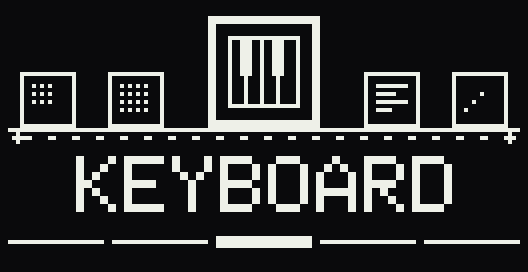

## 4. Eight tracks on four buttons

Move's own answer to more than four tracks is to show them four at a time on the track buttons [18.2]. Feverdream
does the same with two banks: **A** is tracks 1-4, **B** is tracks 5-8.

| Gesture | Does | |
|---|---|---|
| Track button | select that track in the current bank; enter Note Mode | [M] |
| The selected track's button again, inside a device | the map row: on, its other side, off (section 6.7) | [New] |
| The selected track's button again, at the chain | the next view: Chain, Scene, Scope, Scope 8, Tracks (section 6.9) | [New] |
| Track button held | view the track while held, without selecting it | [M] |
| Track button held + Volume | track volume | [M] |
| Mute + track button | mute | [M] |
| Shift + Mute + track button | solo | [M] |
| **Shift + track button** | select the same row in the other bank, and switch the buttons to that bank | [New] |
| Track button held + wheel | pan | [M+] |
| Track button held + encoder 1-4 | Send A, Send B, and two more mix values | [M+] |
| Copy + track button, then a track button | copy the whole track | [M+, from 18.2] |
| Delete + track button | clear the track; one Undo brings it back | [M+, from 18.2] |

The track's number stands in a box at the left of the screen's one large line, and the track buttons' colours give
the bank away at a glance, warm for 1-4 and cool for 5-8, so the bank is never in doubt. While Shift is held the
track buttons show the other bank's colours, so the result of Shift + track is visible before it is pressed.
A track is picked in one way only: its button, in its bank. The steps never pick tracks in Note Mode.

The table above is Note Mode. In Session Mode all eight tracks are on the pads at once and the track buttons launch
scenes (section 8.1).

Send A, Send B and Master are not on the track buttons. They live in Session Mode, where Move keeps its main effects
[17.2] (section 8.3).

## 5. Modes

The same three modes as Move, reached the same way [5].

| Mode | Reached by | For |
|---|---|---|
| Projects | Shift + Step 1 | open, create, copy, delete, colour, rename projects |
| Note Mode | a track button, or the Note/Session toggle | play, sequence, record, edit one track |
| Session Mode | the Note/Session toggle | launch clips and scenes, mix, bus effects |

A quick click on the Note/Session toggle switches mode [M]. Holding it is the left-hand Shift (section 11.1); on
Move a hold previews the other mode, which Feverdream gives up. Back returns from Projects to the mode that was open
before [M].

Inside Note Mode there are temporary states, each lit on its own button and shown by a symbol in the screen's corner: Loop Mode (Loop),
Sampling Mode (Sampling), the browser (wheel pressed), a menu (Shift + a step). All of them exist in Move and are left
the same way: the button again, Back, or a track button.

### 5.1 Projects

Identical to Move's Set Overview [6]: 32 pads, colour for a project, pulsing for the open one, white for a selected
empty slot. Press a pad then a track button to create; Play previews; hold a pad and turn Volume for the project
level; Copy + pad then pad; Delete + pad twice. Shift + pad opens the options: Colour [M], then Rename, Duplicate and
Export [New]. Rename uses Move's wheel keyboard from the Wi-Fi password screen [2.1.2].

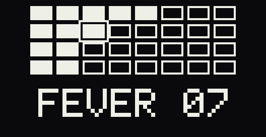

## 6. Note Mode: devices

A track is a chain of devices, as a track in Live is. On the screen the chain is a belt (section 3.5): the devices
ride it in signal order into MIX. Move's Device View shows a track's devices as a row of icons in
signal order, and the wheel moves along it [7.1]. Feverdream keeps that view and opens the chain up: devices can be
added, removed, swapped and put in a different order, and the track has macros over all of them.

`RACK | MACROS | PADS · SEQ · MIDI effects · INSTRUMENT · audio effects · MIX`

| Zone | Devices | How many |
|---|---|---|
| Rack | the chain as a whole, under the name of its preset: the item at the front, for saving and loading it (section 6.8) | one |
| Macros | the track's own eight knobs, in banks (section 6.6) | one bank to start; more are added |
| Notes in | PADS, the pad layout, and SEQ, the sequencer | one of each, always there. They can be swapped for another kind, not removed or moved |
| MIDI effects | arp, chord, scale, random, strum and the like | as many as are added, in any order; a new track has one place for them, empty |
| Instrument | the sound; a sample-based one shows its sample as a second icon [M] | exactly one |
| Audio effects | filter, delay, reverb and the like | as many as are added, in any order; a new track has one place for them, empty |
| Mix | the track's strip | one, always last |

**The rack is dynamic.** A new track is the shortest chain that plays: `MACROS · MIDI FX · SOUND · FX`, with PADS
and SEQ in front of the MIDI effects and MIX at the end, as always. The MIDI FX and FX places are empty to begin
with and show as a +. Filling one opens the next + beside it, so the chain grows as it is used and is never
longer than what is in it. How many MIDI effects, audio effects and macro banks a track may hold is not fixed
here: the limits are sized once it is measured what the processor carries with eight tracks playing
(`ARCHITECTURE.md`).

A device moves only inside its zone: an audio effect cannot go in front of the instrument. A row longer than the
screen scrolls, with a mark at the edge it continues past.

**Two levels, as on Push.** At the chain, the wheel walks the devices and the encoders are the track's macros. A
press enters the device under the wheel: the encoders become its parameters and the wheel turns its pages. Back
leaves it.

| Device | Is | Encoders, first page |
|---|---|---|
| PADS | the pad layout (sections 6.3, 6.4): what the pads play, before anything is sequenced | the layout's own values; for Chords: voicing, perform, amount, roots, style, bank |
| SEQ | the clip's sequencer (section 7) | TRIG: micro, ratchet, chance, condition, function, amount, length, slide |
| A MIDI effect | arp, chord, scale, random, strum | the effect's values |
| The instrument | a synth, a sampler, a kit | its main bank [M] |
| An audio effect | filter, delay, reverb | the effect's values [M] |
| MIX | the track's strip | volume, pan, Send A, Send B, drive, width, output, input |

**At the chain** (home in Note Mode):

| Gesture | Does | |
|---|---|---|
| Wheel turn | move along the chain | [M] |
| **Wheel press** | enter the device: its parameters on the encoders | [New; on Move this press opens the browser, which is now the next press] |
| Wheel press on a + | browse devices to add there. A + stands at the end of the MIDI effects and of the audio effects while there is room | [M+] |
| Wheel turned fully left, onto the rack's name, then press | the rack's sheet: Load, Save, Save As, Init, Revert (section 6.8) | [M+: on Move this is where Track Presets are browsed, 7.2] |
| **Shift + wheel turn** | move the device along its zone; the row redraws as it moves | [New] |
| Shift + wheel press | the device's options: Replace, Bypass, Move, Copy, Delete, Save Preset | [M, 7.1] |
| Mute + wheel press | bypass the device; its icon is struck through | [M, from 18.1] |
| Delete + wheel press | remove the device; one Undo brings it back | [M+] |
| Copy + wheel press, then press on a + | copy the device | [M+] |
| Encoders | the track's macros (section 6.6) | [New] |

**Inside a device:**

| Gesture | Does | |
|---|---|---|
| Wheel turn | its pages, one after another with no wrap (below). Before the first page: the device's name, its front item | [New] |
| Wheel press on the front item | the device's sheet: Load, Save, Save As, Init, Revert (section 6.8) | [M+] |
| Wheel press on a page | the list of its pages by name; the wheel picks one and a press goes there | [New, as RemoteFM1's jog click] |
| Back | out to the chain. Back held: home | [M] |
| Encoder touch | that parameter takes the screen: its name and value, large | [M] |
| Encoder turn | change the value; Shift for fine steps | [M] |
| **An encoder touched + wheel press** | that parameter's options: Map to Macro, Delete Automation, Reset | [New] |
| Left / Right, Plus / Minus, the pads, the steps | as at the chain: entering a device changes only the wheel and the encoders | |

The picture says which level this is: a row of icons at the chain, eight pictograms inside a device. A touch of
the wheel says it in words.
Selecting a track returns to the chain, with the wheel on the device last entered.

**Pages.** A device's pages run in this order: its name at the front, for saving and loading (section 6.8); its
**main page**, which is its theme with its eight key parameters (section 6.1); then its parameters in named pages
of eight, grouped the way the device is thought about. A synth might have OSC A, OSC B, FILTER, ENV, LFO and MIX
after its main page; a delay might need no more than its main page; the sequencer has TRIG, MORE and CLIP.

- The wheel turns the pages. On arriving, the page's name shows large for a moment (`FILTER`), then its eight
  parameters. With Speech on it is said: `Drift, Filter, page 3 of 6`.
- At rest the page is its eight pictograms with its name large over them. A strip has a segment for each page, the
  current one thick, so the length of the walk is always visible. A touch of the wheel gives the device, the page
  and the count in words (`DRIFT`, `FILTER 3/6`).
- A device opens on its main page the first time, and after that on the page it was last left on.
- A page may use fewer than eight encoders. The ones with no job are dark and dead (rules R3 and R4).
- Related things share a column across pages where they can, so a hand finds them: level on encoder 8, for
  instance, on every oscillator page.
- A press on any page lists the pages by name, for a device with many; the wheel picks one and a press goes there.
- The strip's first mark is the device's front item, drawn as a square, not a segment, so it is never mistaken for
  a page of parameters.
- A lock, an automation lane or a macro points at a parameter, not at a place on a page, so pages can be rearranged
  in a later version without breaking a project.

### 6.1 Themes: every device its own weird world

Every device has a **theme**: a small animated world of its own, weird on purpose, in the spirit of the h1
firmware for the FM-1, where each instrument is a place: a koi pond, a pinball table that is a drum kit, a garden
in the rain, a cat by a window with a record turning. The themes are not one family. A delay may be a canyon with
a ball bouncing down it, a filter a tide coming in under a pier, a reverb a cathedral with something flying in it.
Each device is designed with its theme, as part of what the device is.

**The main page.** The first page of every device, straight after its name at the front, is its theme, full
screen, with the device's eight **key parameters** on the encoders. It is the page a device opens on the first
time, and the one to play it from.

- **Each key parameter is something in the world.** Feedback is how many times the ball bounces; time is how far
  apart; the filter on the repeats is the fog it bounces into. Turning the encoder changes the thing, and the
  thing is how the value is read at rest.
- **Modulation is seen in it** (rule 9). An LFO on the delay time makes the bounces breathe. Nothing on the main
  page needs a pictogram: the world is the pictogram.
- **Sound moves it.** Notes and signal are events in the world: a note is a fish that jumps where its pitch puts it
  and as hard as its velocity; a kit has an actor for each pad; an effect is driven by what passes through it.
- **Time passes in it.** The bar and the beat are in its motion.
- **It moves like a thing.** Motion is on springs, not on a timer, so it settles and overshoots as weight does, and
  it is the same at any frame rate.
- **Touch is unchanged.** A touched encoder takes the screen with the parameter's name and the value being set
  (section 3.1), and the world comes back when it is let go. So the main page never has to carry a word.
- The key parameters are not extra parameters. Each is one of the device's own, which also has its place on a page
  further in. The main page is the short way to the eight that matter most.
- A theme is line art on black, one dot wide, with dither for shade, to suit a one-bit screen. Its emblem is the
  device's icon in the chain.
- A theme is never the only place something is shown, and all of it can be said. Reduce Motion holds it still.

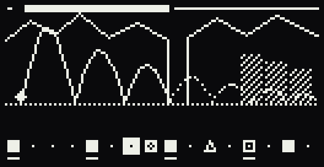

**The pages further in** are plain. A page of parameters at rest is eight **pictograms**, two rows of four, laid out
as the encoders are, with no words: each draws its own value as the sound is using it now, moving when it is
modulated (section 3.1). This is the Syntakt half: regular, always in the same place. The main page is the OP-1
half. Touching an encoder turns either into words.

The sequencer's main page is RemoteFM1's picture: a piano roll of the page shown, with the row of 16 steps always
under it. MIX's is the strip itself. MACROS has no world of its own: its page is the instrument's.

### 6.2 The browser

As Move [7.2]: the wheel scrolls and loads as it goes when Autoload is on, Back goes up a folder, press to close.
Categories are Move's plus one level for track type at the top of the Track Preset list: Synths, Samplers, Sample
Kits, Synth Kits, MIDI, FX Bus, Audio Loops, Templates, User Presets. LED hints while browsing are Move's: all pads
pulse for a Track Preset, encoder LEDs pulse for an effect, the pad pulses for a kit sample.

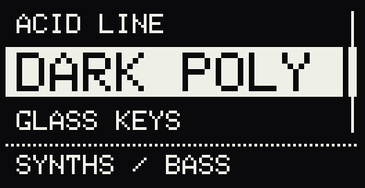

### 6.3 Pad layouts

The pad layout is the first device in the row, PADS. Like any device it has presets (its front item), a main page, and a
page of values on the encoders. Shift + Step 8 (Layout) is the shortcut: each quick click steps to the next layout
the track's type allows. On a kit that is Move's own 16 Pitches switch [M, 9.2]. The layout's name shows as a toast,
and the pads redraw at once.

What the pads play is decided here, before the sequencer. A step always holds the notes that sounded, whatever
layout made them.

| Layout | Tracks | The pads |
|---|---|---|
| In Key | melodic | the scale's notes only, a row an octave or a fourth [M, 9.1] |
| Chromatic | melodic | every note, a row a fourth up, as a fretboard [M, 9.1] |
| **Keyboard** | melodic | a piano: two octaves, each starting on C [New] |
| **Chords** | melodic | chord keys, eight chord pads and a row of roots: ChoralRoot's Move layout [New, section 6.4] |
| **Progression** | melodic | the Keyboard layout's keys, each playing the chord stored on it: Ripchord packs [New, section 6.5] |
| Kit | kits | the left 16 pads are the kit [M] |
| 16 Pitches | kits | the right 16 pads play the selected pad at 16 pitches [M, 9.2] |
| 16 Velocities | kits | the right 16 pads play the selected pad at 16 levels [New] |
| Perform | any | punch-in effects, fills and mutes [New] |

**Keyboard** is the layout Move players ask for. Two rows make one octave, laid out as a piano's keys are: the lower
row is the white keys, the row above it the black keys, each black key above and between its two white ones.

```
row 1    .   C#  D#  .   F#  G#  A#  .      upper octave, black keys
row 2    C   D   E   F   G   A   B   C      upper octave, white keys
row 3    .   C#  D#  .   F#  G#  A#  .      lower octave, black keys
row 4    C   D   E   F   G   A   B   C      lower octave, white keys
```

- Both octaves start on C at the left, whatever the project's key. The top C of the lower octave and the bottom C of
  the upper octave are the same note, as the two ends of an octave are on a piano.
- Lights: every C in the track colour, the other white keys light grey, the black keys dim. The three pads in each
  black-key row that are not keys are dark and do nothing (rule R1).
- With a scale set in Keys & Scales, the notes in the scale are brighter than the notes outside it. Nothing is hidden
  or moved: the layout stays a piano.
- Plus and Minus move both octaves by an octave [M]. The popup names the range (`Octave +1`, `C3 - C5`) and a white
  row sweeps across the pads in the direction moved, as in RemoteFM1.
- A held step shows its notes in white on these pads, as in every layout [M].

RemoteFM1's FM-1 layout also puts an octave on two rows, but it copies the FM-1's own keyboard and does not start on
C. Its Octave layout is a row an octave in the scale, which is Move's In Key.

### 6.4 Chords

The Chords layout is ChoralRoot's Move interface (`ChoralRootFM1`, `firmware/src/cr_move.c`, the owner's design of 20
November 2026) made a layout any melodic track can use. One hand holds a chord, the other plays its root.

```
row 1    DIM  MIN  MAJ  SUS  |  1    2    3    4       chord types      |  chord pads
row 2    6    m7   M7   9    |  5    6    7    8       extensions       |  chord pads
row 3    .    C#   D#   .    F#   G#   A#   .          roots: one octave of a piano,
row 4    C    D    E    F    G    A    B    C          or the scale's degrees
```

**Chord keys** (the left half of the top two rows). Hold one type and any extensions, then press a root.

| Key | Adds above the root |
|---|---|
| DIM | 3 and 6 semitones |
| MIN | 3 and 7 |
| MAJ | 4 and 7 |
| SUS | 5 and 7 |
| 6 | 9 |
| m7 | 10 |
| M7 | 11 |
| 9 | 14 |

- Extensions stack: MAJ + 6 + 9 is a six-nine chord. With two types held, the one pressed last counts.
- A root with no chord key is a single note, unless the roots are the scale's degrees (below).
- **Lock**: Shift + a chord key latches the chord keys that are down, and they stay lit. From then on a type key
  replaces the type, and an extension key switches its extension on or off. Shift + the lit type again unlocks.

**Roots** (the two lower rows), chosen on the PADS page:

| Roots | The rows | A root on its own |
|---|---|---|
| Keys | one octave of the Keyboard layout, C to C | a single note |
| Scale | the degrees of the project's key, eight a row, two octaves | the chord that belongs on that degree: in C major, D gives D minor, B gives B diminished. A held chord key overrides it |
| Chromatic | every note, a row a fourth up | a single note |

**Chord pads** (the right half of the top two rows): eight chords kept with the track, in eight banks.

| Gesture | Does |
|---|---|
| A chord pad | plays its chord, with the voicing it was saved with |
| A chord held + a chord pad | saves the chord there; the pad flashes white |
| Delete + a chord pad | clears it |
| Copy + a chord pad, then an empty one | copies it |
| A step held + a chord pad | the step gets that chord |

**The PADS page** in this layout, on the encoders:

| Encoder | Value |
|---|---|
| 1 VOICING | each click moves the lowest note up an octave, or the highest down; -12 to +12. ChoralRoot's knob 1 |
| 2 PERFORM | how the chord is played: Off, Strum, Strum 2, Slop, Arp, Arp 2, Pattern, Harp |
| 3 AMOUNT | the perform mode's amount |
| 4 ROOTS | Keys, Scale, Chromatic |
| 5 STYLE | what a chord key does while a root is down: Simple (nothing), Advanced (replays the held chord), Free (also sounds the last root again) |
| 6 EXT | an extension pressed late adds its note alone, or strikes the whole chord again |
| 7 6TH | with a seventh, the sixth as played or an octave up (a thirteenth) |
| 8 BANK | the bank of chord pads, 1-8 |

**The screen.** The main page of PADS in this layout is the chord: its name as the largest thing on the screen (`Dm7`),
its notes as voiced under it with the extension notes marked, the chord keys that are down or locked beside it.
With another device open, playing a chord does not disturb the screen; a touch of the wheel names it.

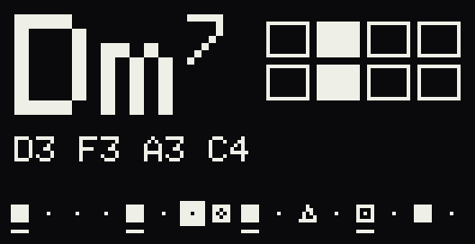

**Lights.** Zones are told apart by colour, as Move does with pink in Sampling Mode: chord types violet, extensions
orange, chord pads teal, each dim when idle and full when down or locked. An empty chord pad is dark. Roots follow
the Keyboard layout's rules. These are ChoralRoot's colours, kept so the layout is the one the owner already plays.

**In the sequencer** a chord is its notes. Pads then a step, a clicked step taking the last chord, recording and
Capture all store the notes that sounded, voiced as they were. The step card names the chord its notes make
(`Dm7`, `G7/B`), as RemoteFM1's does. Nothing in a clip depends on the layout staying on.

Left for later from ChoralRoot: the bass layer and the secret chords. Progressions are a layout of their own
(section 6.5), not part of this one.

### 6.5 Progression

The Progression layout plays a *progression*: a set of stored chords, one chord a key, written exactly as they
sound. It is Ripchord's idea, and it is laid out the way Ripchord packs are made to be played: on a chromatic
keyboard. The pads are the Keyboard layout (section 6.3), two octaves each starting on C, and every key plays the
chord stored for that key.

```
row 1    .      C#dim  Ebmaj7  .      D7/F#  E7/G#  Bb9    .         accents on the black keys
row 2    Cmaj7  Dm7    Em7     Fmaj7  G7     Am7    Bm7b5  Cmaj7     the main chords on the white keys
row 3    .      C#dim  Ebmaj7  .      D7/F#  E7/G#  Bb9    .
row 4    Cmaj7  Dm7    Em7     Fmaj7  G7     Am7    Bm7b5  Cmaj7
```

- **A chord stays on the key its pack put it on.** People who make packs put the main chords on the white keys and
  the accents on the black keys; the layout keeps that, so a pack plays here as its maker meant.
- Plus and Minus move the two octaves along the keyboard, an octave at a time, to reach every key a progression
  uses. Choosing a progression opens on the octave of its lowest chord. The popup names the range (`C2 - C4`).
- Lights: a key with a chord is lit, the white keys in light grey with every C in the track colour, the black keys
  dim; a key with no chord is dark and silent. A sounding chord's key is white.
- The screen is the chord: its name from its notes as the largest thing (`Em9`, `C7/E`), the notes under it, and
  which progression and key (`Neo Soul, E3`).
- Delete + a key clears its chord. Copy + a key, then another key, copies it. A progression changed on the unit is
  saved under its own name in the library; the factory and imported ones are not overwritten.

**The PADS page** in this layout:

| Encoder | Value |
|---|---|
| 1 PROG | which progression, from the library; its name large while turning |
| 2 VOICING | as in the Chords layout: the lowest note up an octave, or the highest down |
| 3 PERFORM | Off, Strum, Strum 2, Slop, Arp, Arp 2, Pattern, Harp |
| 4 AMOUNT | the perform mode's amount |
| 5 VELOCITY | 50 to 150% of the touch |
| 6 HUMANIZE | a random velocity for each note of the chord |
| 7 TRANSPOSE | -24 to +24 semitones, the chords only: the keys stay where they are |

Encoder 8 has no job here and is dark.

**In the sequencer** a progression chord is its notes, as every chord is (section 6.4). A clip does not change when
the progression is edited later.

**Ripchord packs.** Progressions are files in the library. Feverdream Manager's Progressions page takes Ripchord
`.rpc` files, many at once, and writes them back out as `.rpc`:

- each chord is kept on the trigger note Ripchord has it on, so nothing moves and the black keys stay black;
- every trigger in the file is kept;
- a chord of more than eight notes loses its doubled notes first, then notes from the middle; the lowest and
  highest stay. The page says which chords were cut.

The page also edits a progression chord by chord on a drawn keyboard, with the chords named and a Listen button.
Six progressions ship with Feverdream, ChoralRoot's own: Pop Four, Jazz ii-V-I, Neo Soul, Gospel Walk, Minor Epic
and Dorian Days.

This differs from ChoralRoot in one way. ChoralRoot counts a pack's chords from its lowest trigger and lays them
along its keys in that order; here a chord keeps its own key. A pack that starts on C is the same on both.

### 6.6 Macros

A macro is a knob of the track's own that turns one or more parameters anywhere in its chain, each between limits
of its own, as a macro on a Live rack does. Macros come in banks of eight. A track starts with one bank and more
are added; the limit is sized with the chain's (section 6).

- **At the chain the encoders are the macros.** A track is played from here: its eight most useful controls are
  under the hands without entering anything. Factory presets arrive with the first bank mapped, so a Move player
  who touches an encoder hears the sound change, as on Move.
- **Mapping**, the quick way: the map row (section 6.7). Hold a macro's key on the top row of pads and turn the
  parameter's encoder.
- **Mapping**, by menu: inside a device, touch the parameter's encoder and press the wheel, choose Map to Macro, turn
  to the macro, press. Its pictogram then carries a mark. The same menu unmaps it.
- **MACROS** is the second thing in the chain, after the rack's own name. Entering it shows the banks as its pages. A macro touched + wheel
  press gives its options: Rename, Range of each parameter it turns, Clear. The web interface shows all of this at
  once.
- **A macro is a parameter.** It can be locked on a step, recorded as automation, and mapped from MIDI, as any
  other. Holding a step at the chain and turning an encoder locks that macro on the step, which is Move's per-step
  automation gesture at the level a player lives on.
- A rack preset saves the chain and its macros together (section 6.8).

### 6.7 The map row: modulation and macros

A synth's envelopes and LFOs are assigned through a modulation matrix, and assigning one should not mean leaving the
page being worked on. The model is Serum's: take a source and put it on a knob. On Feverdream the sources are keys
on the top row of pads. **Hold a source, turn the knob of the parameter it should move.** The turn makes the routing
and sets its depth in one motion. EvilGenius on the Move maps its envelopes and LFOs the same way.

**The map row** is the top row of pads, inside a device, when it is switched on. The three rows under it still play.

| Side | The eight keys | For |
|---|---|---|
| MOD | the device's modulation sources: its envelopes, its LFOs, then velocity, pressure and the like | a device that has sources, such as a synth |
| MACRO | the eight macros of the bank shown | any device |

| Gesture | Does |
|---|---|
| The selected track's button, quick click, inside a device | the map row on: MOD first if the device has sources, else MACRO. Again: the other side. Again: off |
| **A source key held + an encoder turned** | that source now moves that parameter; the turn is the depth, either way from zero. The parameter's own value does not change while the key is held |
| A source key held + the wheel | the device's pages, as ever: one hold can put a source on parameters on several pages |
| A source key held + Delete + an encoder touched | that routing removed. Turning its depth to zero removes it too |
| A source key, quick click | go to that source's own page (LFO 1's rate and shape, ENV 2's times) |
| **A macro key held + an encoder turned** | that parameter joins the macro; the turn is how far the macro moves it |
| A macro key, quick click | show and say what the macro turns |

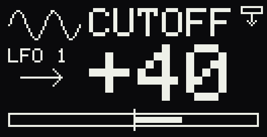

While a key is held, the instrument says what can be done with it:

- The screen names the source and the parameter under the hand, with the depth as the largest thing:
  `LFO 1 > Cutoff  +40`. With Speech on it is said.
- The lights under the encoders show this source's reach on the page: its own colour where it already moves a
  parameter, amber where it could, dark where the parameter cannot be modulated.
- On the device's page each pictogram this source moves carries a mark.
- The key itself is full while held. At rest the keys are dim, in one colour for envelopes, another for LFOs and
  grey for the rest; a key whose source moves nothing yet is dimmer still.

**The matrix page.** Every routing made this way is a row in the synth's MATRIX page: source, parameter, depth. Its
encoders are the depths of the eight routings shown, so a depth can be locked on a step or automated like any
parameter, and Delete + an encoder removes a routing there too. A synth has a fixed number of routings; when they
are used up the screen says `Matrix full` and nothing is changed.

A source can move another source's parameter (an envelope on an LFO's rate) by the same gesture: hold the envelope's
key, walk to the LFO's page, turn rate.

The menu route to a macro (section 6.6: a parameter's encoder touched + wheel press, Map to Macro) stays for when
the row is off.

Which sources a synth has, and how many routings, belongs to the synth's own design, which is not yet done.

### 6.8 Saving and loading

One pattern serves everything that can be saved. **The thing's own name stands at its front, and a press on it
opens the same short sheet.**

| What | Is | Its front item is |
|---|---|---|
| A **rack** | a track's whole chain: every device with its values, the order, the macros and what they turn, the mix strip. Move's Track Preset [7.1], grown to fit | the first item of the chain, before MACROS |
| A **device** | one device: its values, its modulation routings, the samples it uses | the first of its pages, before the first parameter page |
| A bus chain | Send A's, Send B's or Master's effects as one | the first item of that chain, in Session Mode |
| A kit pad | the one sound on a pad of a kit | the first page of that pad's sound |
| A progression | section 6.5 | the PROG value of its PADS page |

The front item shows the name of the preset the thing came from, with a mark beside it once anything has changed
since it was loaded or saved. Turning the wheel all the way left always reaches it, at either level.

**The sheet**, always these entries in this order:

| Entry | Does |
|---|---|
| Load | the browser (section 6.2), opened where this preset lives. Presets are heard as the wheel passes them when Autoload is on [M]; a press keeps one; Undo brings back what was there before |
| Save | writes over the preset it came from. Greyed out for a factory preset, which cannot be written over |
| Save As | a new preset in the user's library. The name is offered ready-made, as on Move [7.3]: the old name with a number. A press takes it; the wheel keyboard changes it |
| Init | the thing as new: an empty rack of this track's type, or the device with its default values. One Undo brings the old one back |
| Revert | back to the preset as it was last loaded or saved |

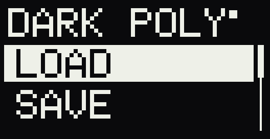

The sheet follows rule R3: the wheel moves along it, a press does the entry, Back closes it. It says each entry and
the preset's name when Speech is on.

**What loading keeps.**

- Loading a **rack** changes the track's sound and leaves its clips alone. Locks on macros keep working, because a
  macro is known by its place in its bank; this is the reason to play and lock through macros. A lock on a device's
  own parameter keeps working when the new rack has the same kind of device in the same place in its zone, and
  falls silent when it does not. Nothing is thrown away: Undo restores the old rack with every lock.
- Loading a **device** preset changes only that device. Macros that turn its parameters go on turning them.
  Replacing it with a different kind of device (Shift + wheel press, Replace) drops what pointed at the old one,
  and Undo restores it.
- A rack whose type differs from the track's changes the track's type, as in section 2.

**The library.** Racks are filed by track type and then by character (Synths: Bass, Keys, Pad, Lead and so on), as
Move files its Track Presets. Devices are filed by kind of device. Each has a User folder, where Save As writes;
factory presets are read-only. Feverdream Manager's Presets page shows both, and takes and gives single preset
files, so a rack can be passed to someone else with its samples inside it.

**Shortcuts.** Shift + wheel press on a device still offers Save Preset among its options [M, 7.3]. Shift + Capture
is left as it is on Move.

### 6.9 Views: scenes, scopes, tracks

The rest picture of a track is not fixed. It is one of five **views**, and the chain of icons is only the first.
A view fills the screen and has no words. Touch brings the words as ever (section 3.1), and the chain shows
itself whenever the wheel is touched or turned, then gives the screen back.

| View | Shows |
|---|---|
| Chain | the track's devices as icons. The default |
| **Scene** | the instrument's scene: a small animated world that the playing moves |
| **Scope** | the track's sound as a waveform, full screen |
| **Scope 8** | all eight tracks' waveforms at once, two rows of four as the encoders lie |
| **Tracks** | the steps of the four tracks of the bank, one row a track |

The selected track's button, clicked again at the chain, steps to the next view. Its name is said, and shown large
for a moment. Each track remembers its view.

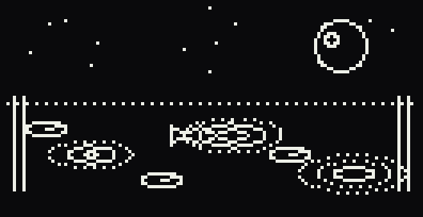 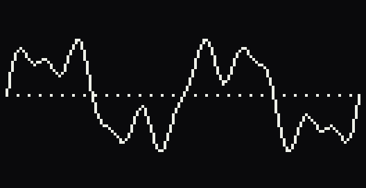

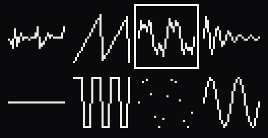 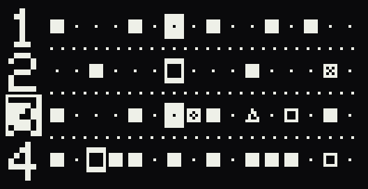

**Scene.** The Scene view is the instrument's theme (section 6.1): the same world as its main page, shown as the
track's rest picture at the chain. Here the encoders are the macros, and what the macros do to the instrument's
key parameters is seen in the world. An effect's theme is seen on that effect's own main page, inside it; at the
chain the scene is always the instrument's. With Speech on, the scene is named once, when the view is chosen.

**Scope.** The track's output drawn as one waveform across the screen, held still on its pitch so that a note is a
shape and not a blur. Inside a device the scope shows the sound as it leaves that device, so walking the chain with
the wheel shows what each effect does to the wave.

**Scope 8.** Eight small scopes, two rows of four, each track under its own encoder. The selected track's is
framed; a muted track's is drawn dotted; a silent one is a flat line. It is the picture of the whole project
sounding. In Session Mode it is also the first place on the wheel, before LEVEL (section 8.2).

**Tracks.** The four tracks of the bank as four rows of sixteen steps, in the order of the track buttons beside
the pads. Each row is that track's own page with its own playhead, since tracks may differ in length and speed. The
marks are the steps row's (section 3.1). Each row begins with its track's number, large, and the selected track's
is boxed. It
answers "what is everything else doing" without leaving the track being played. Plus and Minus are still the
octave here; the other bank's four are seen by selecting a track in it.

## 7. Sequencing

### 7.1 Steps

As Move [9.5], with RemoteFM1's refinements, which the owner judges right (section 15).

- **Pads, then a step**: the step gets exactly the held notes, with their velocities [M].
- **Quick click on an empty step**: it gets *the last notes*: the last step entered or edited, else the last pad
  chord, else the root. No pad needs holding. The pads show the last notes in the track colour, so what a click will
  enter is visible before it is made.
- **Quick click on a step with notes**: cleared [M]. Both act at the release (section 1.1).
- **A hold never clears a step.** With the transport stopped it plays the step, so a step can be auditioned.
- Only Play starts and stops the transport. (Move starts it on the first note in an empty clip; this is RemoteFM1's
  rule and a small departure.)

Step lights: white is a note, dim track colour an empty step in the clip, grey outside the loop, green the playhead
[M]. Added: full track colour for a held step, blinking white for a copied step, and dark for the dead steps of a
triplet page. Left and Right move between pages, without wrapping. On kits the steps show the selected pad only [M].

### 7.2 Holding a step

Everything Move does with a held step still happens [11]. The screen shows a **step card** so the result is visible.

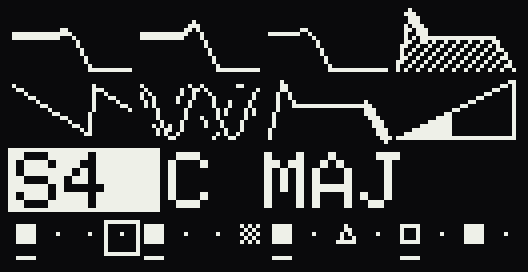

| While a step is held | Does | |
|---|---|---|
| Volume | velocity | [M] |
| Wheel turn | note length, a tenth of a step per click; Shift: whole steps | [M+] |
| **A later step** | stretch the notes to end there; the same step again: back to one step | [New, RemoteFM1] |
| Plus / Minus | transpose a semitone; held, or with Shift: an octave | [M+] |
| Left / Right | nudge a tenth of a step; Shift: a hundredth; held: a whole step | [M] |
| A pad | add or remove that note, up to eight on a step | [M] |
| An encoder | lock what that encoder shows on this step: a macro at the chain, a parameter inside a device | [M, 14.2.4] |
| **Wheel press** | the encoders go to the TRIG page, and stay there when the step is let go. A step held and the wheel pressed again: back to the page it came from | [New] |
| **Mute** | mute the step, keeping what is on it | [New] |
| Delete + an encoder | remove that lock from the step | [M+] |
| Several steps held | all of the above on all of them; ranges shown where values differ | [M] |

**A held step locks the page that is showing.** Holding a step never changes what the encoders are: they stay on
the page the player is on, and turning one locks that parameter on the step. It does not take the encoders by
itself.

**Step + wheel press goes to TRIG and back.** With a step held, a press of the wheel puts the TRIG page on the
encoders, from any device and any page. It stays when the step is let go, so one step after another can be
given its chance, condition or ratchet. A step held and the wheel pressed again goes back to the page it came
from. While TRIG is shown this way the screen's corner carries the TRIG symbol (rule 5), and Back also goes
back.

**Parameter locks are Move's per-step automation**, with two additions. A lock can be placed on a step with no note:
the step lights in bright track colour. And any device in the row can be locked, including MIX, MIDI FX and the
sequencer itself. To lock a filter sweep on step 5: select the filter with the wheel, hold step 5, turn the encoder.
The steps the lock covers turn red while the encoder is touched [M].

### 7.3 The TRIG page: chance, conditions, micro timing, functions

The first page of SEQ is **TRIG**: the properties of a step that Move has no control for. It is RemoteFM1's TRIG page
with its knobs in the same places, so the owner's hands already know it. With no step held, the encoders set the
defaults for steps entered next. With a step held, they set that step. This is the same rule as every other device.

| Encoder | Value | Range |
|---|---|---|
| 1 MICRO | micro timing; the same value as step + Left / Right | half a step early to half a step late |
| 2 RATCH | ratchets: hits spread over the step | 1-8 |
| 3 CHANCE | probability the step plays | 1-100% |
| 4 COND | when the step plays | none, 1:2 to 8:8, FILL, !FILL, PRE, !PRE, NEI, !NEI, 1ST, !1ST |
| 5 FUNC | a step function, run when the step plays | none, RESTART, REVERSE, FORWARD, FLIP, RANDOM, RND FN, LEAP, JUMP, JUMP PG, REPEAT |
| 6 AMOUNT | the function's number, up to 32, so it reaches across two pages | LEAP: steps to leap, -32 to +32. JUMP: the step to go to, 1-32, counted from the loop's start. JUMP PG: the page to go to, 1-16. REPEAT: how many more times the step plays, 1-32 |
| 7 LENGTH | note length by the table; the same value as step + wheel | 1/8 of a step to 64 steps, or held until the next note |
| 8 SLIDE | glide into the next note | off, on |

**Functions** act on the track's playhead, not on the note. RESTART goes back to the loop's start. REVERSE and
FORWARD set the direction and FLIP turns it round. RANDOM jumps to a random step, and RND FN does a random one of
these. LEAP skips a number of steps. JUMP goes to a named step, and JUMP PG to the first step of a named page. REPEAT holds
the playhead on its step: the step plays again, the amount of times, and only then does the playhead move on. Nothing
under it is skipped, so the track runs that many steps late. Because each track has its own playhead, functions on one
track put it out of step with the others on purpose: that is what they are for.

**Fill** is Shift + Loop, held: the FILL conditions pass while it is down. The Loop light blinks fast, the
screen's corner shows the Fill symbol, and a diagonal in the track colour runs across the pads, which still play.

COND and FUNC are lists: the encoder moves one item for every few clicks, so an item is not passed by accident.

The second page holds velocity (the same value as step + Volume) and the ramp of a ratchet's velocities. The third
page holds the clip's own settings (section 7.5).

Trig values are stored as locks on the step. Copy, cut, paste, Double Loop and Undo therefore carry them with no
special case.

Because the condition and chance are invisible on a white LED, the steps row of the screen shows them. Each of the 16
cells is a step of the page shown: a solid square is a note that always plays, a dithered square has a chance, a
hollow square has a condition, a triangle is a lock with no note, a tick above a square is a note with locks. The cell
under the playhead is inverted.

### 7.4 Pages and length

Move's Loop Mode shows a clip's bars on the 16 step buttons, up to 16 bars [12.1]. A Feverdream page is the same
thing: 16 steps on the buttons, up to 16 pages in a clip. The scheme is RemoteFM1's page edit, which is Move's Loop
Mode with the owner's corrections.

| Gesture | Does | |
|---|---|---|
| Loop, quick click | Loop Mode latched: the steps are the pages. Loop again, or Back, leaves | [M] |
| Loop, held | the same while held; a hold let go unused does not latch | [M] |
| A page, quick click | show that page, one past the clip's end too. A tap only shows: the loop and the clip stay as they were | [M] |
| Hold a page, press another | the loop is those pages and the ones between, any of the sixteen; the page shown moves into it | [M] |
| Double click a page | the loop is that page alone, always, never a range. Any page, one past the clip's end too. One Undo brings back the loop before the first click | [M, RemoteFM1] |
| **Wheel** | the loop's length, a step a click; Shift: a page. Up to 16 pages | [RemoteFM1; Move's wheel moves a bar] |
| **The two lower pad rows** | the last page's length: pad 1-16 ends it after that many steps. Lit up to the length, the length itself white. No pad plays | [New, RemoteFM1] |
| **The pad row above them** | the clip's speed: eight pads, 1/16X to 2X from the left, blue, the current one white (section 7.5) | [New, the owner's] |
| **The top pad row** | the feel, at the right: pad 7 STRAIGHT, pad 8 TRIPLET, blue, the current one white. Pads 1-6 are dark | [New, the owner's] |
| Hold a page + wheel / Volume / Plus / Minus / arrows | length, velocity, pitch, nudge for all its notes | [M] |
| Copy + a page, then an empty page | copy it; a clipboard of its own, apart from the steps' | [M] |
| Delete + a page, then an empty page | cut it and paste it; Back clears the mark | [M+] |
| Shift + Step 15 | double the loop | [M] |
| Left / Right | the page shown, with no wrap; the same in and out of Loop Mode | [M] |
| Right, past the clip's last page | pages the clip does not have yet, each shown as +. Out of Loop Mode one becomes real when a step goes in. In Loop Mode pressing its key confirms the new pages, the clip reaching to that page; only for one reached with Right, not one a tap showed. Leaving adds nothing | [M, RemoteFM1] |
| Back held + Left | the first page | [RemoteFM1] |
| Back held + Loop | trim: the loop becomes the pages with steps on them, from the first such page to the last. A loop of 8 pages with steps on pages 1 and 2 becomes pages 1 and 2. With no steps anywhere, nothing changes | [New, the owner's; RemoteFM1 sets the loop to the whole clip] |

Page lights: track colour in the loop, white for the page shown, pulsing for the page playing, dim for the clip's
pages outside the loop, off past the clip. A page past the clip can still be pressed.

A step entered after the loop's end, on the loop's own last page, leaves the loop's length alone: the note is
outside the loop and its step is dim. A step on a later page grows the loop to that page's end.

A clip of 53 steps reads `3 Pages + 5` and its last page shows five lit steps and eleven dark ones. While the length
is being set, the popup's bottom row is that last page's 16 steps, and for the popup's second the step lights show
them too.

The page shown follows only the player's hands. It does not move with the playhead unless Page Follow is switched on
in Workflow Settings.

Loop Mode is RemoteFM1's, whole: pages picked with a click, a loop made from one page to another, a double click
for one page alone, the two lower pad rows for the last page's length, Right for a new page that becomes real
when its key is pressed or a step goes into it. One Move gesture is given up for it: in Move's Loop Mode a held bar
plus a pad adds that note to every step of the bar [11.9]. The pads are the page length instead (rule R3: a layer
that uses some pads takes them all).

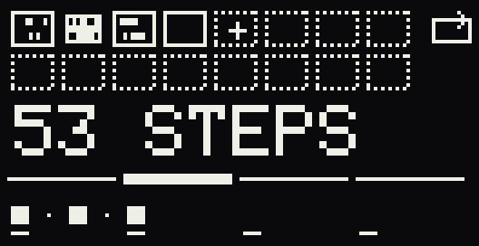

### 7.5 Speed

Move has one Step Grid for the Set, in Workflow Settings [13.2]. In Feverdream each clip has a **speed**: how fast
its steps go by, against a step that is a 16th note. It is the first encoder of the SEQ clip page, and in Loop Mode
it is a row of pads (section 7.4).

| Speed | A step lasts | |
|---|---|---|
| 1/16X | 1 bar | |
| 1/8X | half a bar | |
| 1/4X | a quarter note | |
| 1/2X | an eighth note | |
| 3/4X | an eighth-note triplet | three steps to a quarter note |
| **1X** | a 16th note | the default |
| 3/2X | a 16th-note triplet | six steps to a quarter note |
| 2X | a 32nd note | |

- Eight speeds, so in Loop Mode they are one row of eight pads, blue, the current one white, in this order from
  the left. A press sets the speed at once. With Speech on it is said: `Speed: three quarters`.
- **Feel**: straight or triplet, the second encoder of the clip page and, in Loop Mode, the last two pads of the
  top row, under the right hand. Triplet uses three steps of every group of four: the fourth step of each group is dark and dead, leaving
  12 live steps a page, as on Move [13.2] and RemoteFM1. The three share the time of the four, so a page lasts as
  long as it did and each step is a third longer. Said: `Feel: triplet`.
- Also on the page: length in steps, direction (forward, reverse, pendulum, random), swing, transpose.

A new clip takes the track's speed. Changing the speed changes how fast the clip runs, so tracks can run at
different speeds and in different meters against each other. A separate tool, Regrid, keeps the notes where they
are in time and changes the resolution, which is what Move's Step Grid does.

### 7.6 MIDI FX, generators and other sequencers

**MIDI FX** sit in the chain between SEQ and the instrument and are browsed, bypassed, copied and locked like any other
device. Shift + Step 11 keeps its Move meaning: it opens the track's Repeat / Arp [11.6], which is now the first MIDI
FX.

**The arp** starts from RemoteFM1's, which the owner calls good but not finished. Kept: three pages (main, a MOD lane,
a TRANSPOSE lane); on a lane page the 16 step buttons are the lane's steps; the clip's notes feed the arp; recording
stores what was played, not what the arp made of it. A quick click on Shift + Step 11 opens it, a hold switches it on
or off, and the step's icon stays lit while it is on. An arp that is on but can never sound says `ARP SILENT`, as
RemoteFM1's now does.

**The arp's main page, laid out anew.** RemoteFM1's order was PATTERN, RATE, RANGE, an empty knob, MODE, GATE,
OCT DIST, QUANT: pitch and time mixed, and a hole at knob 4. Now the left hand has which notes and the right
hand has when.

| Encoder | Value | Was |
|---|---|---|
| 1 PATTERN | the walk: UP to AS PLAYED | knob 1 |
| 2 RANGE | octaves, 8 down to 8 up | knob 3 |
| 3 OCT DIST | how far apart the passes are | knob 7 |
| 4 MODE | OFF, ON, 1-ST, ONCE, HOLD | knob 5 |
| 5 RATE | 1/1 to 1/64, with triplets and quintuplets | knob 2 |
| 6 GATE | how long each note lasts | knob 6 |
| 7 SWING | the arp's own shuffle, from none to full | new, in the empty place |
| 8 QUANT | when a run starts: at once, or on the next 1/n | knob 8 |

RANGE and OCT DIST sit together because one says how many octaves and the other how far apart. MODE is the
left hand's last knob, next to the wheel whose click turns the arp off and on. RATE opens the right hand, GATE
keeps its place, and QUANT stays last. SWING is the one new value.

**The sequencer is a device too.** The default is Step, described above. Pressing the wheel on SEQ opens the browser
on other sequencers: Euclid, Lanes (a length and rate per kit pad), Turing, Chords, Random Walk. These are the
*track generators*: they make notes from a few values on the encoders instead of from steps. A generator can be left
running, or frozen:

- **Capture** on a generator writes what it just played into the clip as ordinary steps. This is Move's Capture
  [14.3] with a new source: the machine's playing as well as yours.

**Customizable sequencers** are sequencer devices written as a script and edited in the web interface
(`ARCHITECTURE.md`, section 8). On the unit they look and behave like the built-in ones: eight named values per page,
a face, presets.

### 7.7 Copy and Delete

RemoteFM1's rules, which the owner judges very good, apply to steps, pages, clips, chord pads, tracks and devices.

**Both are modifiers only.** Pressed and let go alone, Copy and Delete change nothing. This is a departure from Move,
where Copy alone duplicates the clip and Delete alone deletes it [12.3, 12.4]: no clip is ever lost to a stray
press. Shift + Step 14 makes a clip, Shift + Step 15 doubles one, and Delete held + Play clears the selected clip.
Because neither has a click of its own, its mark on the screen appears at the press, with no wait: scissors for
Delete, two sheets for Copy.

**One clipboard, and a paste never empties it.** It pastes again and again until something else is copied or cut.

**Nothing pops up.** What was taken is marked where it is: dashed for copied, crossed for cut, on the screen's steps
row, on the Session grid and on the lights (copied blinks white). Back clears the marks; the clipboard stays.

| Held | Then | Does |
|---|---|---|
| Copy | a step with notes | copied. Several in one hold: a group |
| Copy | an empty step | the clipboard pasted there; a group from that step on |
| Copy | let go after copying, then a step | pasted there once, Move's way [11.8] |
| Delete | a step with notes | cut: gone, into the clipboard, crossed |
| Delete | an empty step | the clipboard pasted there |
| Delete | any step right after a cut, in the same hold | the cut pasted there, replacing what was on it |
| Delete | let go | the last action forgotten; the clipboard stays |
| Delete | a pad | that note out of the whole clip [M] |
| Delete | an encoder | its automation deleted [M]; with a step held, that lock |
| Delete | Play | the selected clip cleared, the transport as it was |

Copy never overwrites a full step: pressing one copies it too. Only Delete, right after a cut, replaces.

In Session Mode:

| Held | Then | Does |
|---|---|---|
| Copy | a clip | copied, dashed while it waits |
| Copy | an empty slot | the clip pasted there; the buffer stays |
| Copy | another clip, while one waits | replaced by it |
| Delete | a clip | deleted at the press, crossed until Delete is let go; one Undo brings it back |
| Delete | an empty slot | nothing: Delete never pastes a clip |
| Copy let go | | nothing waits: the next plain press launches |

Pages in Loop Mode have a clipboard of their own and follow the step rules (section 7.4). Tracks and devices are
copied with Copy held and deleted with Delete held (sections 4 and 6); a deleted track or device comes back with one
Undo.

## 8. Session Mode

### 8.1 Clips

**Each column of pads is a track and each row is a scene.** All eight tracks are on the pads at once, with four of the
sixteen scenes. This is the layout of Live, of Push, and of Move itself in Control Live Mode [18.7, 18.8]. It is
turned from Move's standalone Session Mode, where rows are tracks [17]: with eight tracks, that would hide half of
them behind a bank switch while performing.

Everything that belongs to a track is in its column: its encoder above, its clips on the pads, its two step buttons
below, its meter on the screen.

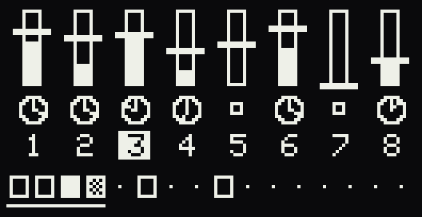

| Gesture | Does | |
|---|---|---|
| Pad | launch the clip; at the next bar if the transport runs | [M] |
| Empty pad in a playing track | select the slot and stop the track | [M] |
| Shift + pad | select the clip without launching it | [M, from 18.8] |
| Copy + pad, then pad | copy a clip (section 7.7) | [M] |
| Delete + pad | delete a clip; one Undo brings it back | [M] |
| Shift + Play | retrigger every playing clip | [M] |
| **Track button** | launch the scene beside it on all 8 tracks; a scene with no clips stops every clip | [New] |
| **Track button, double click** | stop every clip at the launch quantize. The first click queues the scene and the second takes that back and queues the stop, so the scene is never heard. With the launch quantize at none the scene starts at the first click and stops at the second | [New] |
| Slide along a row | the same: launch the scene | [M+, Move's slide, turned] |
| Copy + track button, then a track button | copy a scene | [M, from 18.8] |
| Delete + track button | delete a scene; one Undo brings it back | [M, from 18.8] |
| Plus / Minus | the scenes shown, by one; Shift: by four | [M, from 18.7] |
| Left / Right | select the previous or next track | [M+] |
| **Odd step under a column** (1, 3 ... 15) | quick click: select that track; double click: open it in Note Mode | [M, from 18.7] |
| **Even step under a column** (2, 4 ... 16) | stop that track's clip at the launch quantize | [M, from 18.7] |
| Odd step held + Volume | that track's level | [M, from 18.1] |
| Mute + odd step | mute the track; Shift + Mute: solo | [M+] |
| Note/Session | Note Mode on the selected track | [M] |

Pad colours are Move's: track colour for a clip, pulsing white for the clip a track has selected and is playing,
pulsing green for queued, pulsing track colour for about to stop. A track button is dim white for a scene with clips
and green for the scene that is playing. A track's odd step is its colour (white when selected, dim when muted, blue
when soloed); its even step is lit while the track has something to stop.

The track buttons therefore mean two things: tracks in Note Mode, scenes in Session Mode. The picture on the screen and their
colours (track colours in Note Mode, white and green in Session Mode) say which.

The launch quantize is an entry in Workflow Settings: none, 1/16, 1/4, 1 bar (Move's behaviour and the default), 2, 4
or 8 bars, clip end.

### 8.2 Mixing

In Session Mode the eight encoders are the eight tracks, each above its column of clips.

| Wheel position | Encoders 1-8 |
|---|---|
| SCOPES | track volumes; the screen is Scope 8 (section 6.9): the eight tracks' waveforms |
| LEVEL (home) | track volumes; the screen is the meters |
| PAN | track pans |
| SEND A | each track's send to A |
| SEND B | each track's send to B |

**The wheel is a belt** (section 3.5). Touching or turning it shows Session Mode's belt: these five pages as
boxes, then the buses' effects (section 8.3), riding into OUT at the right. The box in the middle is large, with
its name under the belt. A page is live as it reaches the middle, with no press, as a page inside a device is: the
encoders are its eight values at once. When the wheel is let go the screen goes back to that page's picture.

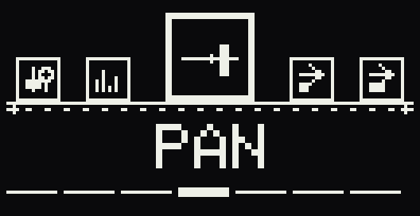

At rest the screen shows eight meters with the value marks on them and, under each, the playing clip's progress as a small
ring. Its bottom row is the sixteen scenes, with the four on the pads underlined. Touching an encoder names its track. Volume on its own is the master level [M]; a track button held with Volume
is still that track's level [M].

### 8.3 Sends and Master

Turning the wheel further along the same belt reaches the buses, where Move has its two main effects [17.2].

`SCOPES · LEVEL · PAN · SEND A · SEND B | A: effects | B: effects | MASTER: effects · OUT`

Each bus is a chain of audio effects, none to four, with the same gestures as a track's chain (section 6): a press
enters a device, Back leaves it, Shift + wheel moves it, a + adds one. While the wheel is on an effect's box the
encoders keep the mix page last shown, until a press enters the effect. OUT is the machine the belt runs into, as
MIX is for a track. It holds the limiter that Move hides
[16.8], the master level and the metering. Clips can lock and automate bus parameters as they can any other.

## 9. Recording, capture and automation

All as Move [14]. Record starts after the count-in, the button is red while recording and the clip grows until it is
stopped. Capture takes what was just played. Record with an encoder turned writes automation: a filled circle by the
value, a red encoder LED. Mute + an encoder switches a parameter's automation off and on. Delete + an encoder removes
it. Turning an automated encoder overrides it until it is let go.

Additions:

- Automation and locks are the same data. A recorded sweep can be edited a step at a time by holding steps, and a set
  of locks can be smoothed into a sweep with a tool.
- Workflow Settings gains Record Mode (overdub, replace) and Record Quantize.
- Undo names what it undid in a toast.

## 10. Sampling

Sampling Mode is Move's [15]: press Sampling, the pads that can take a sample turn pink, press a pad to start and
again to stop, or hold it and let go. The wheel chooses the source, the gain and monitoring. Slicing is Move's
Slicing Mode [15.8]. What follows makes it as quick as Koala.

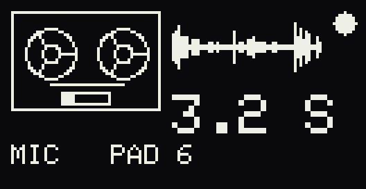

| Addition | What it does |
|---|---|
| More sources | Mic, Line, USB-C, Resample (Master) [M], then any single track and either send |
| Threshold | recording waits for sound, so the sample starts on the hit |
| Bar sync | when resampling, start on the next bar and stop after 1, 2, 4 or 8 bars: a loop that fits without trimming |
| **Grab** (Shift + Sampling, then a pad) | the last 1, 2, 4 or 8 bars that Feverdream played are always kept; Grab puts them on the pad. Resampling after the fact, as Capture is for notes |
| **Bounce** (Tools, on Shift + Step 13, then a pad or a clip slot) | renders exactly the selected clip, track or scene, one pass, cut to the bar. Grab keeps what happened; Bounce makes what is written |
| Trim card | after every recording: the waveform with start and end on encoders 1 and 2, and Reverse, Normalize, Trim Silence, Chop on the pads' top row. Play the pad to hear it; Back or any other control accepts |
| Any track type | a kit pad or sampler key takes the sample [M]; an Audio Loops track takes it into the selected clip as a loop; a synth track becomes a sampler [M] |
| Tape face | the screen shows a tape recorder: reels turn while recording, the waveform runs out of it, the level is a needle |

Recordings are named after the project as Move names them and appear under User Recordings [M].

## 11. The Shift map

All sixteen steps have an icon printed under them, and each icon has its own white light (CC 16-31). Thirteen are in
the Move manual and keep their Move meanings. Three are printed on the unit but appear nowhere in the manual: step 4
(a cylinder), step 12 (layers merging into one) and step 13 (a star, which Schwung uses for its Tools menu). Feverdream
gives these three the new entries, each chosen to match its picture, so the printed icon is still a true label. The
screen's Shift card names all sixteen.

| Step | Shift + step | |
|---|---|---|
| 1 | Projects (Set Overview) | [M] |
| 2 | Setup: **Speech** (Off, On, Jog) first, then Wi-Fi, Feverdream Manager, MIDI, brightness, about, **Exit to Move** | [M+] |
| 3 | Workflow Settings: Quantize, Step Grid, Count-In, Autoload, Launch Quantize, Record Mode, Page Follow | [M+] |
| **4** (cylinder) | **Track Setup**: type, name, colour, MIDI channel, voices, output. The cylinder read as the track's body | [New] |
| 5 | Tempo; wheel sets, Shift for fine, press confirms. Each further press of Step 5 is a tap of the tempo, as in RemoteFM1 | [M+] |
| 6 | Metronome | [M] |
| 7 | Groove; encoder 1-8 set how much each track takes | [M+] |
| 8 | Pad layout (section 6.3). Melodic tracks: In Key, Chromatic, **Keyboard**, **Chords**, **Progression**. Kits: 16 Pitches [M], 16 Velocities. Then **Perform** on any track | [M+] |
| 9 | Keys & Scales | [M] |
| 10 | Full Velocity | [M] |
| 11 | Repeat / Arp: the track's first MIDI FX | [M] |
| **12** (layers merging) | **Mixer**: Session Mode's mix pages over Note Mode. The encoders are the eight tracks' levels, and the wheel turns to PAN, SEND A and SEND B (section 8.2); the pads and steps still play the track. Step 12 again, or Back, leaves. The layers merging read as tracks mixed into one | [New] |
| **13** (star) | **Tools**: transpose, shift, reverse, randomize, humanize, regrid, locks to automation, **Bounce** (section 10). The same step as Schwung's Tools and EvilGenius's | [New] |
| 14 | New Clip: select the track's next empty slot | [M, from 18.1] |
| 15 | Double Loop | [M] |
| 16 | Quantize | [M] |

Other Shift combinations:

| Gesture | Does | |
|---|---|---|
| Shift + Undo | redo | [M] |
| Shift + Play | retrigger | [M] |
| Shift + Capture | clear what Capture is holding | [M] |
| Shift + encoder | fine steps; on some parameters, the second value | [M] |
| Shift + Plus / Minus | shift the pads by a scale degree; in Session Mode, four scenes | [M, from 18.4, 18.7] |
| Shift + Left / Right | first page, last page | [M+] |
| Shift + track button | the other bank | [New] |
| Shift + wheel turn | at the chain: move the device along its zone | [New] |
| Shift + Sampling | Grab | [New] |
| Shift + Loop, held | Fill (section 7.3) | [RemoteFM1] |
| Shift + Record | record settings: mode, quantize, count-in | [RemoteFM1] |
| Shift, double click | Shift latched until Shift is clicked again; the screen's corner shows the Shift symbol | [RemoteFM1 and Melodee] |
| Undo, held | the list of recent actions; the wheel picks how far back to go | [Melodee] |

### 11.1 Two Shifts

Move's Shift is at the bottom right. Held in the lap, the right hand is the one on the pads and encoders, so Shift +
an encoder, or Shift + a step on the right, needs a third hand. **Holding the Note/Session toggle is a second Shift,
under the left thumb.** It does everything Shift does: the Shift map appears, the printed icons light, and whatever
is pressed or turned gets its Shift meaning.

| Target is under | Use |
|---|---|
| the right hand: encoders, pads, steps, track buttons | Note/Session held, with the left thumb |
| the left hand: the wheel, Play, Back | Shift, with the right hand |

How one button does both jobs:

- Quick click: the mode switches, on release.
- Hold, or anything else pressed or turned while it is down: it is Shift, and the mode does not switch when it is
  let go. The Shift map appears only once it is held.

The price is Move's preview: holding the toggle no longer shows the other mode while held [5]. Two quick clicks do
the same job. The mode also switches as the button comes up, not as it goes down, which is a few hundredths of a
second later than on Move.

The other modifiers (Copy, Delete, Mute, Loop) stay on the right only. Their targets can all be reached by the left
hand: track buttons, the wheel, and the pads, steps and encoders nearest it. If playing shows that one of them needs
a left-hand twin, Back held is the candidate.

## 12. Look and motion

The brief is a mix of the OP-1 and the Syntakt on a 128 x 64 one-bit screen.

**From the Syntakt: structure.** A fixed grid. Eight parameters are always in the same eight places as the eight
encoders. Selection is inversion. A value is a number, in the same place every time.

**From the OP-1: character.** Every device is a drawing, not a list. Line art one pixel wide on black. The drawing is
driven by the sound. Things in the pictures are things: a room, a spring, a tape, a mouth. Large numerals when one
value matters.

**From the Fors devices in `feverdream-design/inspiration`: pictograms.** Each parameter has a 16 x 12 picture that
shows its value: an envelope bends, a square wave narrows, dots scatter. A page of eight reads as shapes before it
reads as text.

**From RemoteFM1 and Melodee: restraint.** Symbols at rest, words only while something is touched or turned. One
subject on the screen at a time. The one number that matters is the largest thing there. A strip at the bottom says
where you are in a row of pages: thin segments, the current one thick. Any screen that is not home ends with a line
saying what a press and Back will do (`Press: Keep   Back: Up`). A question that can lose work says whether Undo can
bring it back.

Type: three sizes only, all from one 5 x 7 face (section 3.1). The one number at four times, 28 dots tall, five
characters to the line. Names and words at twice, 14 dots tall, ten characters to the line. One smaller line at
its drawn size, 7 dots tall, where a second fact is needed. Nothing smaller is ever used for something that has to
be read, and no screen has more than three lines of text. Two dither patterns stand for "inactive" and "dimmed";
they are never decoration.

Motion rules:

1. 30 frames a second. A transition lasts at most 150 ms and is eased.
2. Motion carries meaning. Pictures move with audio, the playhead or a value. Nothing loops on a timer except the
   idle screen.
3. Text that is being read holds still. Only pictures and bars move.
4. Feedback is immediate: an LED and the first frame of a screen change happen within one frame of the event that
   causes them. That event is the press, the release of a quick click, or the end of the hold window, as section
   1.1 says for the control.
5. LEDs animate in tempo: pulses are a beat long, a queued clip's pulse quickens as its bar approaches, a launched
   scene sends a ripple along its column, the playhead on the steps leaves a one-step tail.
6. A Reduce Motion entry in Setup turns off slides and ripples, leaving values and playheads.

Each device's theme is designed with the device (section 6.1).

## 13. The web interface

Feverdream Manager is laid out as Move Manager [3] so nobody has to learn a second tool: the same hostname entry in
Setup, the same code on the screen to pair, the same pages.

| Page | Contents | |
|---|---|---|
| Projects | list, download, rename, delete, export as audio | [M] |
| Recordings | list, play, download, rename, delete | [M] |
| Samples | folders, upload by drag and drop, play, rename, delete | [M] |
| Presets | folders, upload, rename, delete | [M] |
| Progressions | chord progressions: import and export Ripchord `.rpc` packs, edit chord by chord, listen | [New] |
| Macros | a track's macro banks: names, what each turns and between which limits | [New] |
| Settings | storage, version, update | [M] |
| Remote | the screen live, a drawing of the Move that can be clicked, the project as a grid | [New] |
| Sequencers | the script editor for custom sequencers | [New] |
| Export | a project as an Ableton Live Set, stems, or MIDI files | [New] |

## 14. Decisions

Decided:

- **Session layout: columns are tracks** (23 November 2026). Rows as tracks, Move's standalone layout, was the first
  draft's default. It is not kept as an alternative: two layouts would give the arrows, steps and track buttons two
  sets of meanings.
- **Bank switch in Note Mode: Shift + track button** (23 November 2026). Pressing the selected track's button again
  was the alternative. That second press never changes the bank or the track; inside a device it switches the map
  row (section 6.7), which is visible on the pads at once and undone by pressing again.
- **Press terms and the hold window** (23 November 2026): quick click, hold, double click; a 300 ms hold window held
  in one place; nothing shows before the hold; a quick click acts on release (section 1.1).
- **The owner's UX rules R1-R6 apply** (24 November 2026), from RemoteFM1 (section 1.2).
- **Carried over from RemoteFM1** (24 November 2026), where the owner had already decided them: the TRIG page and its
  knob order; functions as RemoteFM1's FUNC list; Fill on Shift + Loop held; straight and triplet feels; Loop Mode's wheel moving a step a click and a page with Shift; the last page's
  length on the two lower pad rows; the last-notes rule for a clicked step; a later step stretching a held step's
  notes.
- **Keyboard pad layout** (24 November 2026): two octaves, each starting on C (section 6.3).
- **Chords pad layout with chord pads** (24 November 2026), after ChoralRoot's Move layout (section 6.4).
- **Copy and Delete as in RemoteFM1** (24 November 2026): modifiers only, so Move's Copy-alone duplicate and
  Delete-alone delete are given up (section 7.7).
- **Tracks are chains of devices, as in Live** (24 November 2026): the wheel walks the devices, a press enters one,
  Back leaves; devices can be reordered inside their zone; a track has macro banks; the pad layout and the
  sequencer are devices too (sections 6 and 6.6).
- **Modulation is seen; the hand's value holds still** (24 November 2026): rule 9 and section 3.1.
- **Views** (24 November 2026): Scene, Scope, Scope 8 and Tracks beside the chain as a track's rest picture
  (section 6.9).
- **Every device its own weird theme** (24 November 2026), after the h1 firmware: the first page of a device, after
  its name, is its main page, the theme full screen with its eight key parameters; the worlds are unrelated, each
  designed with its device (section 6.1).
- **Big, simple, told on touch** (24 November 2026): rule 8 and section 3.1. The first drafts' header of small
  print, eight-cell parameter grid and hint lists are gone; a touched knob or wheel takes the whole screen.
- **One way to save and load** (24 November 2026): a rack's or a device's name stands at its front, and a press on
  it opens the same sheet: Load, Save, Save As, Init, Revert (section 6.8).
- **The map row** (24 November 2026): a source or macro key held on the top row of pads, and a parameter's encoder
  turned, makes a routing and sets its depth, on whatever page of the synth is open. After Serum (section 6.7).
- **Progressions, with Ripchord import** (24 November 2026): a pad layout of their own on the two-octave Keyboard
  layout, each chord on the key its pack put it on, so main chords fall on white keys and accents on black. Not
  part of the Chords layout (section 6.5).
- **A spoken interface for a screen reader, as a rule** (24 November 2026): rule 7 and section 3.4. Schwung's
  screen reader is the voice; the Speech setting has RemoteFM1's Off, On and Jog modes. "Text to speech" in the
  feature list meant this. Typed words made into a sample, which an earlier draft had, is not in the design.
- **The belt** (24 November 2026), after EvilGenius's page belt: kinds of thing are chosen as boxes of pixel art
  on a conveyor, the chosen one large in the middle. The chain of devices is a belt running into MIX, and
  Session Mode's wheel is a belt running into OUT (sections 3.5, 8.2).
- **Left-hand Shift: holding Note/Session** (23 November 2026), for playing in the lap. Move's hold-to-preview on
  that button is given up (section 11.1).

- **A held step locks the page that is showing** (24 November 2026, the owner's). The TRIG page does not take the
  encoders whenever a step is held; a wheel press with the step held shows it (section 7.2).
- **Loop Mode is RemoteFM1's** (24 November 2026, the owner's): the pads are the page length, and Move's "held bar
  plus a pad" is given up (section 7.4).
- **A track is picked by its button, in its bank, and no other way** (24 November 2026, the owner's). Track button
  held + Step 1-8 was proposed and is rejected (section 4).
- **Sixteen clips a track** (24 November 2026), to begin with; more can be added later.
- **Each world is chosen with its device** (24 November 2026), as each synth and effect is designed. The pond and
  the canyon in the pictures are sketches (section 6.1).
- **Shift + Play is Move's retrigger everywhere** (24 November 2026). It was tried as stop all clips in Session
  Mode and taken back, so it has one meaning. An empty scene stops every clip, as on Move (section 8.1).
- **The three unlabelled step icons** (24 November 2026): step 4 Track Setup, step 12 Mixer, step 13 Tools.
  Bounce, which was on step 12, is an entry in Tools (section 11).
- **The rack is dynamic** (24 November 2026, the owner's): a new track starts as MACROS, MIDI FX, SOUND, FX and
  grows as devices are added. The limits are sized later, by measurement (section 6).
- **The first wheel press enters a device** (24 November 2026); its presets are at its front item (section 6).
- **Macro banks change by entering MACROS and turning the wheel** (24 November 2026). A quicker gesture is added
  only if playing it asks for one.
- **Chord zone colours are ChoralRoot's** (24 November 2026): violet, orange and teal, to be checked on the unit
  beside the track colours.
- **The selected track's button, clicked again** (24 November 2026), switches the map row inside a device and
  steps through the views at the chain (sections 6.7, 6.9).
- **The map row is switched on and off, and takes a row of pads while it is on** (24 November 2026, the owner's).

- **The arp's main page** (24 November 2026): PATTERN, RANGE, OCT DIST, MODE, RATE, GATE, SWING, QUANT
  (section 7.6).
- **What rides a track's belt** (24 November 2026): the rack's name, MACROS, PADS, SEQ, the MIDI effects, the
  sound, the audio effects, MIX (section 6).
- **The belt everywhere it was proposed** (24 November 2026): pad layouts, track types, adding a device, Tools and
  views, beside the chain and Session Mode's wheel (section 3.5).

- **Clip speeds** (24 November 2026, the owner's): 1/16X, 1/8X, 1/4X, 1/2X, 3/4X, 1X, 3/2X, 2X, where 1X is a
  16th note a step. In Loop Mode they are a row of blue pads above the page-length pads. This replaces the rate
  list carried over from RemoteFM1 (sections 7.4, 7.5).
- **Feel is straight or triplet, on the two right-hand pads above the speeds** (24 November 2026, the owner's). Triplet uses
  three steps of every four. Dotted, which RemoteFM1's list had, is left out (section 7.5).
- **Loop Mode works exactly as RemoteFM1's page edit** (24 November 2026, the owner's): a tap shows a page, two
  pages held make the loop, a double click loops one page, the wheel sets the length, Right offers new pages. The
  one addition is the row of speed pads (section 7.4).
- **Step + wheel press goes to TRIG and back** (24 November 2026, the owner's): TRIG stays when the step is let
  go; a step held and the wheel pressed again returns to the page it came from (section 7.2).
- **Stop all clips: a double click on a track button in Session Mode** (24 November 2026, the owner's), the
  buttons that launch scenes there. Shift + a stop step was not free, and a double click on a stop step was the
  other candidate (section 8.1).

Open. Nothing: every item raised so far has an answer. New ones are added here as the devices are designed.

## 15. What RemoteFM1 and Melodee teach

Studied on 24 November 2026 from their repositories: `rfm1cs-abletonmove` 0.14.0 with `remoteFM14Move` 0.3.0, and
`melodee-move` 0.4.0. Melodee was read from its documents only, and those say most of it has not been checked on a
unit.

### 15.1 RemoteFM1: what it gets right

Each of these is now in the section named.

| It does | Section |
|---|---|
| A clicked empty step takes the last notes; a hold never clears; a hold auditions the step | 7.1 |
| A held step: Volume, wheel, arrows, Plus / Minus, pads, a later step for length | 7.2 |
| The TRIG page: MICRO, RATCH, CHANCE, COND, FUNC, AMOUNT, LENGTH on one page, per held step | 7.3 |
| Functions that move the track's own playhead, and REPEAT | 7.3 |
| Fill on Shift + Loop, with a light, a word and a pad animation saying it is on | 7.3 |
| Page edit: latched by a quick click on Loop; show, range, solo a page; ghost pages | 7.4 |
| The last page's length on the pads, and the popup that shows that page's steps | 7.4 |
| Arrows walk the pages with no wrap, the same in and out of page edit | 7.4 |
| A speed and a feel per track | 7.5 |
| An arp with lanes on the step buttons | 7.6 |
| Trig values kept as locks, so every edit command carries them | 7.3 |
| The piano roll of the page with the steps row always under it | SEQ's main page, 6.1 |
| Copy and Delete as modifiers only, one clipboard, marks instead of popups, a paste that never empties | 7.7 |
| A spoken interface for a screen reader | 3.4 |
| The UX rules R1-R6 | 1.1, 1.2 |

### 15.2 RemoteFM1: what confuses, and what Feverdream does instead

| In RemoteFM1 | Why it confuses | Here |
|---|---|---|
| 3 firmware slots on Track 1-3, and 16 sequencer tracks routed to them | two numberings; a track's sound is somewhere else | 8 tracks, each with its own sound in its own chain of devices. MIDI is a track type, not a second set of tracks |
| The sequencer is a layout of a slot; the firmware's own controls are another layout | the same buttons belong to two machines in turn | one machine. The sequencer is a device in the chain, entered and edited like the others |
| Shift is the sequencer's in one layout and the firmware's GLO in another | a modifier that changes owner | Shift always means the Shift map |
| The jog wheel: knob page, step length, loop length, bar lengths, menu cursor, arp pages, drum note, FM-1 target, tempo | nine jobs | five, each in a layer that is visibly open: the chain (walk the devices), inside a device (its pages), a held step, Loop Mode, a menu |
| Track buttons: click, hold, double click and Shift, with Track 4 different | four meanings a button, and an odd one out | click selects, hold shows the track's strip, Shift is the other bank; all four the same |
| Seven knob pages on one wheel | long walks | pages belong to a device: the wheel picks the device, a press enters it, the wheel then turns only its pages |

### 15.3 Melodee: why it is approachable

| It does | Here |
|---|---|
| One fixed place on every screen for where you are and the one number that matters (its left rail) | the one large line of the rest view, with the track's number boxed at its left; a touch of the wheel for the rest (3.1) |
| One subject a screen; a touched knob takes the whole screen | the same: the touch view (3.1) |
| A last line of hints at the point of need: what a press and Back will do | adopted (12) |
| Copy, Delete and Mute as verbs held with an object, the same everywhere | the same (3.3), as Move |
| One wheel grammar: turn chooses, press opens, Shift + turn pages, Shift + press options, Back up, Back held home | nearly the same (6): turn chooses, press enters, the wheel then turns the pages, Back up, Back held home |
| One question for anything that loses work, saying whether Undo brings it back | adopted (12) |
| Undo held shows what can be undone | adopted (11) |
| Audio Recall on Shift + Sampling | the same idea as Grab (10) |

Where it differs and Feverdream does not follow:

- Its Session grid is rows as tracks, four in view. Feverdream's is columns as tracks, eight in view (8.1).
- Shift shows nothing on its screen. Here the Shift map appears once Shift is held (3.3).
- Its hold time is 0.4 s. Here it is the one 300 ms hold window (1.1).
- Its TRIG page is behind a held step plus a wheel press only. Here it is also a page of the SEQ device, reached by
  the wheel like any other.
